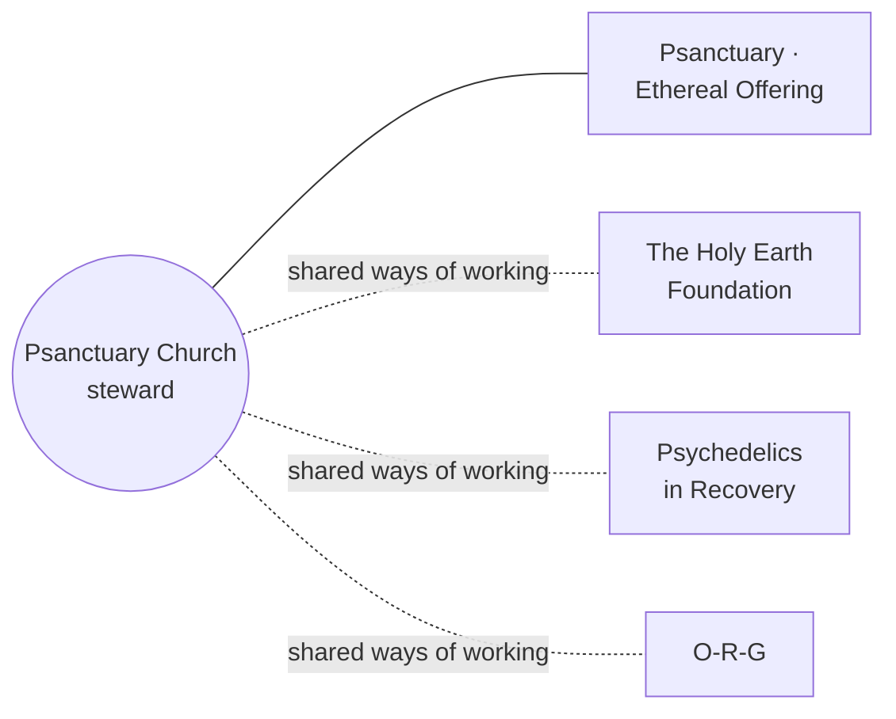

<!-- AUTO-GENERATED MIRROR — do not edit this file directly.
     Source of truth: https://github.com/psanctuarychurch/.github/blob/main/profile/README.md
     This copy refreshes hourly via .github/workflows/mirror-profile-readme.yml -->

  <picture>
    <source media="(prefers-color-scheme: dark)" srcset="https://raw.githubusercontent.com/psanctuarychurch/.github/main/profile/assets/banner-spore.svg">
    
  </picture>

  
  
  
  
  
  
  
  
  
  

In the church's own words, Psanctuary is "an inter-tradition church built on growing together with
a sincere sacred mushroom practice rooted in spiritual autonomy":

> We are a non-profit mushroom church and psilocybin is our sacrament. Unlike anything else in the
> psychedelic ecosystem, Psanctuary offers a model centered on spiritual autonomy, peer support, and
> communal care. No gurus or celebrity shamans here. Just a sincere community, sharing wisdom.
>
> From [psanctuary.org](https://www.psanctuary.org). The church's standing is set out in its own
> [legal notice](https://www.psanctuary.org/legal-notice).

##  Two organizations, one church

The church's home is [psanctuary.org](https://www.psanctuary.org): Sunday service, membership,
courses, ceremonies and events all live there. On GitHub, the church holds two organizations, each
with its own purpose:

| | |
| --- | --- |
|  **psanctuarychurch** (you're here) | The church's **professional face** on GitHub: its official home here, with an open record of everything built for it. |
|  **[psanctuary](https://github.com/psanctuary)** · Ethereal Offering | The **decentralized, playful dimension**: experiments in tools the community can own, a DAO and tokens of gratitude among the ideas being explored. The church is its **steward**. |

##  The mycelium: a steward, and the threads between houses

Mycelium is the part of a mushroom you rarely see: threads beneath the forest floor that carry what one tree has to
another. The church's GitHub home works the same way. It **stewards Psanctuary · Ethereal Offering**, the playful,
community-owned side, and it shares one way of working (proposals that ask, procedures that do, reading rooms that
show, a welcome deck that walks you in) with sibling houses the same helpers serve, each in its own colour and in its
own words.

[The Holy Earth Foundation](https://github.com/theholyearthfoundation) · [Psychedelics in Recovery](https://github.com/psychedelicsinrecovery) · [O-R-G](https://github.com/Octagon-Religious-Research-Group-ORG) · [Psanctuary](https://github.com/psanctuary). Each house keeps its own decisions; nothing is merged between them.

##  Explore

| Where | What you'll find |
| --- | --- |
|  [Entry portal](https://psanctuarychurch.github.io/) | The church's front door on GitHub: the latest changes, who made them, and the way into everything below. |
|  [AstroLog](https://psanctuarychurch.github.io/changelog-astro-public/) | The front porch of the church's record: what changed, how it works, and who did the work. |
|  [Changelog](https://psanctuarychurch.github.io/changelog-astro-public/changelog) | Dated, plain-language entries, newest first, each with the full story folded underneath. |
|  [Library](https://psanctuarychurch.github.io/changelog-astro-public/library) | Longer write-ups on how these pages are built, and why. |
|  [Map](https://psanctuarychurch.github.io/map/) | Every place these pages lead, each with a picture of where it goes. |
|  [Ledger](https://psanctuarychurch.github.io/changelog-astro-public/ledger) | Every public change to the code, in plain words, grouped by day and by kind. Refreshed daily. |
|  [Donate](https://psanctuarychurch.github.io/donate/) | Giving through psanctuary.org, receipts and taxes in the church's own words, a thank-you list, and a wallet preview. |
|  [Pledge](https://psanctuarychurch.github.io/pledge/) | A pledge of support, signed with a wallet: free, nothing sent, nothing recorded, no counts. |
|  [Roadmap](https://psanctuarychurch.github.io/changelog-astro-public/roadmap) | Where these pages are headed, without dates. |
|  [Sustainability](https://psanctuarychurch.github.io/changelog-astro-public/sustainability) | What keeps them running, and the plan for them to outlive any one person. |
|  [Contacts](https://github.com/psanctuarychurch/.github/blob/main/CONTACTS.md) | Every way to reach the church: info@psanctuary.org, the contact form, and its channels. |
|  [Member community](https://psanctuary-member-community.mn.co/) | The church's member network on Mighty Networks: one link to join or sign in. |
|  [Social previews](https://github.com/psanctuarychurch/.github/blob/main/SOCIAL-PREVIEWS.md) | How to refresh link previews in Telegram, LinkedIn, Facebook and more, and which pages have their own share image. |

Every page here shares one arrival kit: choose a light (Candlelight is the church's own), a pace and
a contrast when you arrive, press <kbd>/</kbd> to search, tap the book for reading mode, and see
what's new since your last visit.

##  Welcome deck, reading rooms, procedures

How the church's GitHub home decides, does and explains its work, each page with a PDF beside it.

| | Where | What you'll find |
| --- | --- | --- |
|  | [**Welcome deck**](https://github.com/psanctuarychurch/.github/blob/main/decks/welcome.marp.pdf) ([html](https://github.com/psanctuarychurch/.github/blob/main/decks/welcome.marp.html), [markdown](https://github.com/psanctuarychurch/.github/blob/main/decks/welcome.marp.md)) | **Start here.** Seven stops from "no GitHub account" to "I read, I answer, and my helper reads with me", and who to ask. |
|  | [Public reading room](https://psanctuarychurch.github.io/reading-room-public/) | The front page anyone can open: *Start here*, the procedures marked public, the decks, and the door to the members' room. |
|  | [Members' reading room](https://github.com/psanctuarychurch/reading-room) | The church's proposals, procedures and decks together, for members signed in through the `readers` team (anyone else sees a 404). |
|  | **SOP-COM-001** *New to GitHub: your first hour* ([members' room](https://github.com/psanctuarychurch/reading-room/blob/main/procedures/COM/SOP-COM-001-new-to-github-your-first-hour.md)) | Your own account and password, two-factor sign-in, the invitation, five words, the reading room, a helper. |
|  | [Procedures, public copy](https://github.com/psanctuarychurch/ops-standard-operating-procedures-public) | *This is how we do it now*: the nine procedures every house shares, filled in for the church, with PDFs (listed; they arrive with the first sync). |
|  | [Proposals](https://github.com/psanctuarychurch/reading-room/tree/main/proposals) (members' room) | *Should we?* One folder, one page, a PDF beside it, a decisions log. |
|  | [Decks](https://github.com/psanctuarychurch/.github/tree/main/decks) | Every slide walk-through, as PDF, HTML and the markdown it was made from. |
|  | [Gitmoji](https://github.com/drasticstatic/my-template/blob/main/GITMOJI.md) | How commits are titled here: one gitmoji and a type, `:memo: docs(scope): subject`. |

Proposals and the members' room are for members: ask the technical steward for access, as the welcome deck's last slide explains.

##  People

| | |
| --- | --- |
| **Eric O** | Co-founded Psanctuary with **Courtney M** and **Athena**. |
| **Alana** | A minister leading the church's **Maine** frontier, and part of the web-dev team. |
| **Christopher W** ([@drasticstatic](https://github.com/drasticstatic)) | Leads the **Pennsylvania** frontier, and looks after the church's GitHub home with [Alfred](https://github.com/drasticstatic/anthropas-argus-alfred-public-preview). |

##  Repositories

| Repository | What it holds |
| --- | --- |
| [psanctuarychurch.github.io](https://github.com/psanctuarychurch/psanctuarychurch.github.io) | The entry portal (`/`, `/donate/`, `/pledge/`, `/map/`), which also serves the arrival kit every page here shares. |
| [changelog-astro-public](https://github.com/psanctuarychurch/changelog-astro-public) | The AstroLog's published pages (written in a private source repository). |
| [reading-room-public](https://github.com/psanctuarychurch/reading-room-public) | The reading room's public front page, and only the pages marked public (copied in by a sync, never edited by hand). |
| [ops-standard-operating-procedures-public](https://github.com/psanctuarychurch/ops-standard-operating-procedures-public) | The procedures marked public (copied in by a sync, never edited by hand). |
| [.github](https://github.com/psanctuarychurch/.github) | This profile, the welcome deck in `decks/`, and the defaults every repository here shares. |
| [reading-room](https://github.com/psanctuarychurch/reading-room) · [proposals](https://github.com/psanctuarychurch/proposals) · [ops-standard-operating-procedures](https://github.com/psanctuarychurch/ops-standard-operating-procedures) · [legal](https://github.com/psanctuarychurch/legal) | Members only. Names may be public; contents stay private. |

##  Community health

- [`CONTACTS.md`](https://github.com/psanctuarychurch/.github/blob/main/CONTACTS.md): every way to reach the church
- [`ONBOARDING.md`](https://github.com/psanctuarychurch/.github/blob/main/ONBOARDING.md): **joined the organization? start here**: two-factor login, connecting your AI helper, and how we work
- [`CONTRIBUTING.md`](https://github.com/psanctuarychurch/.github/blob/main/CONTRIBUTING.md): how to contribute, with care for what's sacred, and how commits are titled ([Gitmoji](https://github.com/drasticstatic/my-template/blob/main/GITMOJI.md))
- [`SECURITY.md`](https://github.com/psanctuarychurch/.github/blob/main/SECURITY.md): reporting a security problem
- [`SOCIAL-PREVIEWS.md`](https://github.com/psanctuarychurch/.github/blob/main/SOCIAL-PREVIEWS.md): how to refresh link previews, and which pages have their own share image

##  License

-  **Code:** MIT, see [`LICENSE`](https://github.com/psanctuarychurch/.github/blob/main/LICENSE)
-  **Written content** (docs, changelog and library prose, READMEs): CC BY-SA 4.0, see [`LICENSE-CONTENT`](https://github.com/psanctuarychurch/.github/blob/main/LICENSE-CONTENT)
-  **The Psanctuary name, logos and marks:** not covered by either license, see [`TRADEMARKS.md`](https://github.com/psanctuarychurch/.github/blob/main/TRADEMARKS.md)

---

Gathered from psanctuary.org's own words. The church is welcome to reshape this space whenever it's ready.

